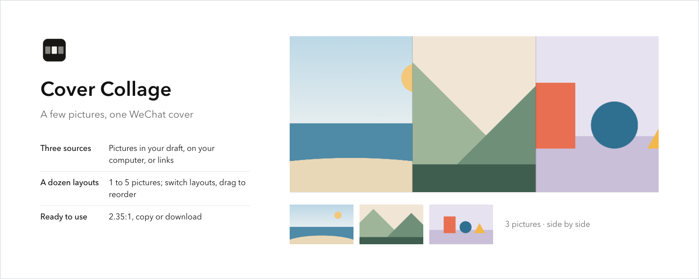
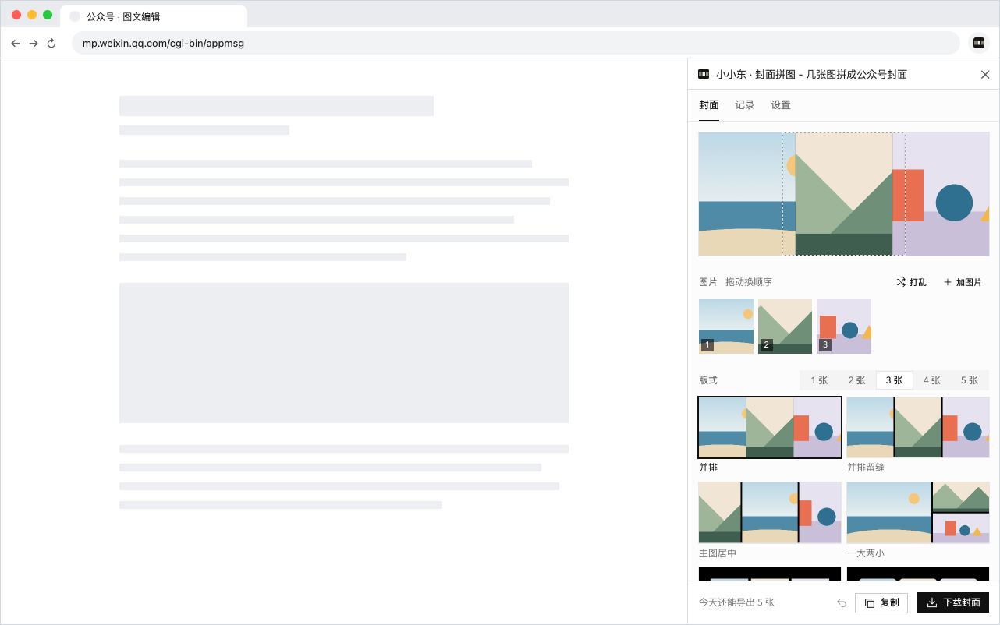

# xxd-chrome-publish

[简体中文](README.md) · [繁體中文](README.zh-TW.md) · [English](README.en.md) · [日本語](README.ja.md) · [한국어](README.ko.md) · [Español](README.es.md) · [Français](README.fr.md) · **Deutsch** · [العربية](README.ar.md)

**Eine Chrome-Erweiterung in den Chrome Web Store bringen und aktuell halten – von der ersten Veröffentlichung bis zu jedem Release, auf der Kommandozeile.**

| Erste Veröffentlichung | Store-Bilder | Jedes Update |
|---|---|---|
| Liest Ihren Code und bereitet Store-Texte, Berechtigungsbegründungen und Datenschutzangaben in der Reihenfolge des Dashboards vor, ein Ordner pro Sprache | Screenshots, Icons und Werbebilder in Farben und Schrift der eigenen Oberfläche – wie ein Produkt | Bauen, packen, hochladen, einreichen – und **vor dem Upload** wissen, ob der Store ablehnt |

Als Befehl oder als Skill in Claude Code / Codex: „Veröffentliche diese Erweiterung“, „Bereite den Store-Eintrag vor“.
MIT-Lizenz. Keine npm-Abhängigkeiten; Screenshots und Bilder installieren beim ersten Mal playwright-core in einen lokalen Cache.

## Was es Ihnen erspart

| Vorher | Damit |
|---|---|
| Upload klappt, Einreichen scheitert: *does not meet the requirements* | Die Vorabprüfung nennt die neue Berechtigung, die eine Begründung braucht, und die Codezeile, die sie nutzt |
| Berechtigungsbegründungen und Datenangaben geraten, passen nicht zum Code | Zuerst wird der Code gelesen: wofür jede Berechtigung dient, welche Server aufgerufen werden, ob Remote-Code läuft |
| Ein Paket in 13 Sprachen, zwölf leere Store-Seiten | Ein Materialordner pro Sprache, vor dem Release bestätigt – auch für Sprachen, die das Paket noch nicht hat (Japanisch, Koreanisch, Arabisch …) |
| Ein 400 px schmaler Seitenbereich, über den ganzen Screenshot gezogen | Seitenbereiche und Pop-ups im Browserfenster aufgenommen, mit Demodaten, offline, ohne echte Konten |
| Werbebilder in Farben, die die Erweiterung nie nutzt | Farben, Schriften und Ecken aus den gerenderten Seiten der Erweiterung gelesen |
| Später geladene Dateien und Lizenzen von Drittbibliotheken fehlen im ZIP | Gefunden und mitgepackt |
| Eine Versionsnummer, die der Store schon hat | Die nächste Version aus Code und Store berechnet |
| Unklar, welche Erweiterungen unveröffentlichte Änderungen haben | Eine Tabelle für alle |

## So sieht es aus

Für die Erweiterung „Cover Collage“ erstellt:





Eine Prüfung vor dem Veröffentlichen:

```
$ xxd-chrome-publish preflight
Image Crop Tool · ~/code/crop · phdjhhjbapkmagifbejfabimojmjngbe
  store     PUBLISHED 1.0.26
  version   1.0.26 → 1.0.27
  package   27 files · 249 KB
  manifest  vs store: +hosts https://api.example.com/*
  dashboard 1 to-do:
    [required] Justify the new host permissions
    open https://chrome.google.com/webstore/devconsole/…/edit/privacy
  => NEEDS DASHBOARD
```

Eine neue Website-Berechtigung. Link öffnen, einen Satz zum Warum schreiben, speichern, veröffentlichen – statt es erst nach Upload, Einreichen und Ablehnung zu erfahren.


## Schnellstart

**1. Installieren** (Node 18+)

```bash
git clone https://github.com/nevertoday/xxd-chrome-publish ~/code/xxd-chrome-publish
sh ~/code/xxd-chrome-publish/scripts/install.sh                       # als Befehl
ln -s ~/code/xxd-chrome-publish ~/.claude/skills/xxd-chrome-publish   # als Claude-Skill (Codex: ~/.codex/skills)
```

**2. Ohne Store-Konto** – im Ordner der Erweiterung:

```bash
xxd-chrome-publish listing .        # Material für die erste Veröffentlichung vorbereiten
xxd-chrome-publish style .          # Farben, Schriften und Ecken der Oberfläche auslesen
xxd-chrome-publish pack . --patch   # Version erhöhen, ein hochladbares ZIP bauen
```

**3. Zum Veröffentlichen das Store-Konto verbinden** (einmalig – [Schritt für Schritt](references/setup.md))

```bash
xxd-chrome-publish setup --publisher-id <ID aus der Dashboard-URL> --service-account <E-Mail des Dienstkontos>
xxd-chrome-publish bind --extension-id <Erweiterungs-ID oder Store-URL>   # einmal pro Erweiterungsordner
xxd-chrome-publish                                                        # veröffentlichen
```

## Drei Situationen und ihre Befehle

### Erste Veröffentlichung

```bash
xxd-chrome-publish listing . --locales ja,ko,ar   # Code lesen, packen, Gerüst in Dashboard-Reihenfolge anlegen
xxd-chrome-publish privacy-page .                 # Datenschutzerklärung veröffentlichen, URL eintragen
xxd-chrome-publish listing . --check              # Offenes, Markdown, zu lange Zusammenfassung, fehlende Dateien
```

Der angelegte Ordner (auf dem Schreibtisch, nie im Quellcode):

```
<Erweiterungsordner>-store-assets/
├── fill-text.md              von oben nach unten einfügen, in Dashboard-Reihenfolge
├── upload-files/             Icon, Screenshots, Werbebilder, Datenschutzseite, ZIP
├── language-versions/<Sprache>/ je Eintragssprache: Einfügetext, ausführliche Notizen, Datenschutzerklärung
└── working/listing-facts.md  die Belege: wo jede Berechtigung genutzt wird, welche Server aufgerufen werden
```

Dann den Eintrag im Dashboard anlegen, das ZIP hochladen und einfügen. Sobald es eine ID gibt, `bind`; die erste Version prüft zuerst Login-Allowlists, ein Testkonto für die Prüfer und eine öffentliche Support-Seite.

### Store-Bilder

| Sie wollen | Eingeben |
|---|---|
| Screenshots nach einem Szenario aufnehmen (`--locale ja` für Japanisch) | `xxd-chrome-publish shots . --scenario shots.json` |
| Den Stil der Oberfläche für Icons und Bilder auslesen | `xxd-chrome-publish style .` |
| Icons 16/32/48/128, Store-Icon und Prüfbogen erzeugen | `xxd-chrome-publish icon . --svg icon.svg` |
| Ein Werbebild rendern und überlaufenden, abgeschnittenen oder umbrechenden Text prüfen | `xxd-chrome-publish tile promo.html --size 1400x560 --out promo.png` |
| Größen und Transparenz prüfen, mit Vorschau der Store-Seite | `xxd-chrome-publish images .` |

Alles zum Hochladen ist 24-Bit-PNG ohne Transparenz, wie der Store es verlangt. Screenshots brauchen Google Chrome; playwright-core landet beim ersten Mal in `~/.cache`.

### Jedes Update

| Sie wollen | Eingeben |
|---|---|
| Sehen, was passieren würde, ohne etwas zu ändern | `xxd-chrome-publish preflight` |
| Das Update veröffentlichen | `xxd-chrome-publish` |
| Nach dem Ergänzen im Dashboard erneut einreichen | `xxd-chrome-publish submit` |
| Den Prüfstatus ansehen | `xxd-chrome-publish status` |
| Sehen, welche Erweiterungen in einem Ordner unveröffentlichte Änderungen haben | `xxd-chrome-publish scan ~/code` |
| Die Kontoeinrichtung prüfen | `xxd-chrome-publish doctor` |

## Im KI-Assistenten

Als Skill installiert, einfach sagen:

- „Veröffentliche die flomo-Erweiterung“, „Welche Erweiterungen kann ich veröffentlichen?“
- „Bereite den Store-Eintrag für diese Erweiterung vor, auch auf Japanisch, Koreanisch und Arabisch“
- „Mach fünf Screenshots und Werbebilder im Stil der Oberfläche“

Jede Veröffentlichung endet mit einem Bericht in festem Format, der drei Dinge trennt: Dashboard gespeichert, Paket hochgeladen, zur Prüfung eingereicht. Eine Einreichung heißt nie „veröffentlicht“ – das kommt nach Googles Freigabe.

## Was es nicht kann


Dafür bietet Google keine API; es passiert im Chrome-Entwickler-Dashboard: den Eintrag anlegen, Store-Texte und Datenschutzangaben einfügen, Bilder hochladen. Das Werkzeug legt Texte und Bilder in der richtigen Reihenfolge bereit, mit den Dashboard-Links. Chrome lässt Erweiterungen keine Store-Seiten steuern; ein KI-Assistent in einer Erweiterung kann sie also nicht ausfüllen, eine KI mit direkter Computersteuerung kann jedes Feld ausfüllen, speichern und zurücklesen.

## Details

<details>
<summary><b>Anmeldung: eine von beiden</b></summary>

| Methode | Für | Braucht |
|---|---|---|
| gcloud + Dienstkonto | den eigenen Rechner, ohne Schlüsseldatei | Google Cloud SDK und ein Dienstkonto |
| OAuth-Refresh-Token | CI (z. B. GitHub Actions) | `CWS_CLIENT_ID`, `CWS_CLIENT_SECRET`, `CWS_REFRESH_TOKEN` |

⚠️ Das Dienstkonto gehört ins Feld **service account** auf der Account-Seite des Dashboards, **nicht** in „Trusted tester accounts“ daneben – das gibt keinen API-Zugriff und endet in 403-Fehlern.

Schritt für Schritt: [references/setup.md](references/setup.md)

</details>

<details>
<summary><b>Alle Optionen fürs Veröffentlichen</b></summary>

| Option | Wirkung |
|---|---|
| `--minor` / `--major` | 1.2.3 → 1.3.0 / 2.0.0 (Standard 1.2.4) |
| `--set-version 1.5.0` | genau diese Version |
| `--no-bump` | Version aus manifest.json beibehalten |
| `--skip-build` / `--skip-checks` | Build- / Prüfskript nicht ausführen |
| `--dashboard-ready` | Dashboard ist erledigt; weitermachen |
| `--cancel-pending` | Version in Prüfung zurückziehen und diese einreichen |
| `--upload-only` | hochladen, nicht einreichen |
| `--staged` | nach der Freigabe warten, bis Sie veröffentlichen |
| `--zip datei.zip` | dieses ZIP hochladen statt eines zu bauen |
| `--commit` | die Versionsänderung danach committen |
| `--json` | maschinenlesbare Ausgabe |
| `--lang zh` / `--lang en` | Sprache des Abschlussberichts und des Store-Namens im ZIP-Dateinamen; Standard ist die Systemsprache |

Exit-Codes: `0` fertig · `1` Fehler · `2` eine andere Version ist in Prüfung · `3` zuerst Dashboard-Aufgaben.
Optionen der Bildbefehle: `xxd-chrome-publish --help`.

</details>

<details>
<summary><b>Einstellungen pro Erweiterung</b> (<code>.chrome-publish.json</code>)</summary>

```json
{
  "extensionId": "abcdefghijklmnopabcdefghijklmnop",
  "build": "npm run build",
  "check": false,
  "packageDir": "dist",
  "include": ["assets/models/**"],
  "exclude": ["fixtures/**"]
}
```

| Feld | Bedeutung |
|---|---|
| `extensionId` | die 32 Buchstaben in der Store-URL |
| `build` | Build-Befehl oder `false`; Standard ist das `build`-Skript in package.json |
| `check` | Testbefehl oder `false`; Standard ist das `check`-Skript in package.json |
| `packageDir` | der zu packende Ordner, z. B. `dist` bei einer Build-Ausgabe |
| `include` / `exclude` | Dateien, die immer / nie mitgepackt werden |

</details>

<details>
<summary><b>Texte für Prüfer und Hilfe bei Fehlern</b></summary>

- Jedes Feld der ersten Veröffentlichung: [references/first-listing.md](references/first-listing.md)
- Screenshot-Szenarien: [references/screenshots.md](references/screenshots.md) · Icons und Werbebilder: [references/store-images.md](references/store-images.md)
- Berechtigungsbegründungen, die durchgehen: [references/dashboard.md](references/dashboard.md)
- Fehler und Lösungen: [references/troubleshooting.md](references/troubleshooting.md)

</details>

<details>
<summary><b>Aktualisieren und entwickeln</b></summary>

```bash
git -C ~/code/xxd-chrome-publish pull   # aktualisieren (Skill-Link und Befehl zeigen hierher)
npm test                                # Tests gegen einen lokalen Fake-Store; nichts wird veröffentlicht
npm run diagrams                        # Diagramme neu erzeugen, nachdem build.mjs geändert wurde
```

</details>

MIT-Lizenz
