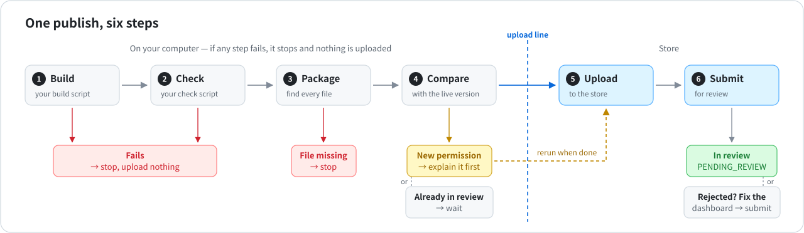
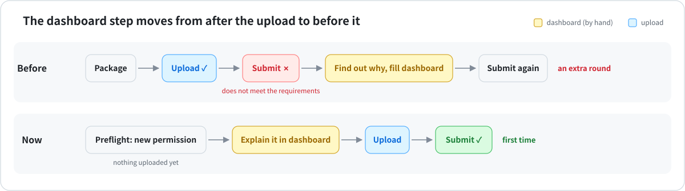
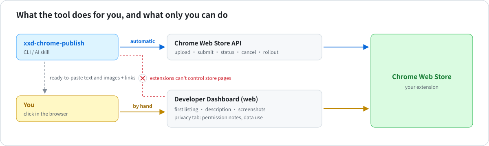

# xxd-chrome-publish

[简体中文](README.md) · [繁體中文](README.zh-TW.md) · [English](README.en.md) · [日本語](README.ja.md) · [한국어](README.ko.md) · [Español](README.es.md) · [Français](README.fr.md) · **Deutsch** · [العربية](README.ar.md)

**Updates für deine Chrome-Erweiterungen mit einem einzigen Befehl veröffentlichen.**
Bauen, zippen, hochladen, zur Prüfung einreichen – und *vor dem Upload* erfahren, ob der Chrome Web Store ablehnen wird.

Nutzbar als Befehl oder als Skill in Claude Code / Codex: Sag einfach „Veröffentliche meine Erweiterung“.

> Erweiterungen im Store bekommen ihre Updates direkt. Für die erste Veröffentlichung bereitet `xxd-chrome-publish listing` die Dashboard-Texte, Berechtigungsbegründungen, Datenschutzangaben und das Paket in jeder Eintragssprache vor; danach legen Sie den Eintrag im Chrome-Dashboard an und fügen ein.



## Was es löst



| Vorher | Mit xxd-chrome-publish |
|---|---|
| Der Upload klappt, dann scheitert das Einreichen: *„does not meet the requirements“* | Du erfährst vorher, welche Berechtigung eine Notiz im Dashboard braucht – und welche Codezeile sie nutzt |
| Dateien, die dein Code erst später lädt, fehlen im Zip – eine Funktion geht kaputt | Sie werden gefunden und eingepackt |
| Versehentlich wird ein alter Build hochgeladen | Deine Build- und Test-Skripte laufen zuerst; schlagen sie fehl, wird nichts hochgeladen |
| Die Versionsnummer kollidiert mit dem Store | Die nächste Version wird aus deinem Code und dem Store ermittelt |
| Du weißt nicht mehr, welche Erweiterungen unveröffentlichte Änderungen haben | Eine Tabelle zeigt alle |
| Ein mehrsprachiges Paket geht hoch, aber die Store-Seiten der anderen Sprachen bleiben leer | Jede Sprache wird aufgelistet; hochgeladen wird erst, wenn du sie im Dashboard geprüft hast |
| Lizenzdateien fehlen im Zip | LICENSE, NOTICE und Lizenzen von Drittbibliotheken werden automatisch eingepackt |

## Schnellstart

**1. Installieren**

```bash
git clone https://github.com/nevertoday/xxd-chrome-publish ~/code/xxd-chrome-publish
ln -s ~/code/xxd-chrome-publish ~/.claude/skills/xxd-chrome-publish   # als Claude-Skill (Codex: ~/.codex/skills)
sh ~/code/xxd-chrome-publish/scripts/install.sh                       # als Befehl
```

**2. Store-Konto verbinden** (einmalig · [Schritt für Schritt](references/setup.md))

```bash
xxd-chrome-publish setup --publisher-id <ID aus der Dashboard-URL> --service-account <E-Mail>
```

**3. Jeden Erweiterungsordner verknüpfen** (einmalig)

```bash
cd meine-erweiterung
xxd-chrome-publish bind --extension-id <Erweiterungs-ID oder Store-Link>
```

**4. Veröffentlichen**

```bash
xxd-chrome-publish
```

## Alltägliche Befehle

| Du willst | Befehl |
|---|---|
| Sehen, was passieren würde, ohne etwas zu ändern | `xxd-chrome-publish preflight` |
| Ein Update veröffentlichen | `xxd-chrome-publish` |
| Nach dem Dashboard-Fix erneut einreichen | `xxd-chrome-publish submit` |
| Den Prüfstatus ansehen | `xxd-chrome-publish status` |
| Sehen, welche Erweiterungen unveröffentlichte Änderungen haben | `xxd-chrome-publish scan ~/code` |
| Prüfen, ob die Einrichtung funktioniert | `xxd-chrome-publish doctor` |
| Erste Veröffentlichung: Dashboard-Material und Paket je Sprache vorbereiten | `xxd-chrome-publish listing . --locales ja,ko,ar` |
| Nur ein ZIP (`--patch` erhöht vorher die Version) | `xxd-chrome-publish pack . --patch` |
| Datenschutzerklärung als öffentliche Seite veröffentlichen und URL eintragen | `xxd-chrome-publish privacy-page .` |

In Claude Code / Codex einfach fragen: *„Veröffentliche die flomo-Erweiterung“*, *„Welche Erweiterungen kann ich veröffentlichen?“*

## Store-Bilder

Es macht auch Screenshots, Icon und Werbebilder – als ein Satz mit der Oberfläche der Erweiterung: Farben, Schriften und Ecken werden aus ihren echten Seiten gelesen, nicht eigens gewählt, und das Hauptmotiv jedes Bildes ergibt sich aus dem, was die Erweiterung tatsächlich tut (das, was sie erzeugt, oder die Website mit ihrem Seitenbereich).

| Sie wollen | Eingeben |
|---|---|
| Store-Screenshots nach einem Szenario aufnehmen (Seitenbereiche und Pop-ups im Browserfenster) | `xxd-chrome-publish shots . --scenario shots.json` |
| Farben, Schriften, Ecken und das aktuelle Icon der Oberfläche auslesen | `xxd-chrome-publish style .` |
| Icons 16/32/48/128, Store-Icon und Prüfbogen erzeugen | `xxd-chrome-publish icon . --svg icon.svg` |
| ein Werbebild rendern und das Layout prüfen | `xxd-chrome-publish tile promo.html --size 1400x560 --out promo.png` |
| Größen und Transparenz prüfen, mit Vorschau der Store-Seite | `xxd-chrome-publish images .` |

- `--locale ja` nimmt die Screenshots für den japanischen Eintrag auf; Aufnahmen laufen offline und nur mit Demodaten.
- Alles zum Hochladen ist 24-Bit-PNG ohne Transparenz, in `<Erweiterungsordner>-store-assets/upload-files/` auf dem Schreibtisch.
- Braucht Google Chrome; playwright-core installiert sich beim ersten Mal selbst (in `~/.cache` – das Paket selbst bleibt ohne Abhängigkeiten).

## So sieht eine Prüfung aus

```
$ xxd-chrome-publish preflight
Image Crop Tool · ~/code/crop · phdjhhjbapkmagifbejfabimojmjngbe
  store     PUBLISHED 1.0.26
  version   1.0.26 → 1.0.27
  package   27 files · 249 KB
  manifest  vs store: +hosts https://api.example.com/*
  dashboard 1 to-do:
    [required] Justify the new host permissions
    open https://chrome.google.com/webstore/devconsole/…/edit/privacy
  => NEEDS DASHBOARD
  stages
    ✗ dashboard  NOT done — 1 required item above
    ✗ package    not uploaded
    ✗ review     not submitted
```

Hier wurde eine neue Website-Berechtigung gefunden. Link öffnen, in einem Satz erklären, wofür die Erweiterung sie braucht, speichern, veröffentlichen. Die letzten drei Zeilen halten die Schritte auseinander – Dashboard gespeichert, Paket hochgeladen, zur Prüfung eingereicht –, damit kein fehlender Schritt untergeht.

## Was es nicht kann



Dafür hat Google keine API, also bleibt es im Chrome-Dashboard:

- den Eintrag anlegen und das Material einfügen (`listing` bereitet es vor; sobald die neue ID existiert, prüft die erste Version hier zuerst Login-Allowlists, ein Testkonto für die Prüfer und eine öffentliche Support-Seite)
- Store-Beschreibung und Screenshots (eine Seite pro Sprache)
- der Datenschutz-Tab: Notizen zu Berechtigungen, Datennutzung, Link zur Datenschutzerklärung

Das Tool sagt dir genau, was du wo eintragen musst. Chrome verbietet Erweiterungen, Store-Seiten zu steuern – ein Agent als Browser-Erweiterung kann es also nicht. Eine KI mit nativer Computersteuerung schon: Sie tippt, lädt hoch, speichert und liest die Seite danach zur Kontrolle noch einmal.

## Details

<details>
<summary><b>Anmelden: zwei Wege</b></summary>

| Weg | Gut für | Was du brauchst |
|---|---|---|
| gcloud + Dienstkonto | den eigenen Rechner, ohne geheime Dateien | Google Cloud SDK, ein Dienstkonto |
| OAuth-Refresh-Token | CI (z. B. GitHub Actions) | `CWS_CLIENT_ID`, `CWS_CLIENT_SECRET`, `CWS_REFRESH_TOKEN` |

⚠️ Das Dienstkonto gehört in das Feld **service account** auf der Account-Seite des Dashboards – **nicht** in „Trusted tester accounts“. Dieses Feld gibt keinen API-Zugriff, und du bekommst 403-Fehler.

Alle Schritte: [references/setup.md](references/setup.md)

</details>

<details>
<summary><b>Alle Optionen</b></summary>

| Option | Wirkung |
|---|---|
| `--minor` / `--major` | 1.2.3 → 1.3.0 / 2.0.0 (Standard ist 1.2.4) |
| `--set-version 1.5.0` | genau diese Version verwenden |
| `--no-bump` | die Version aus manifest.json behalten |
| `--skip-build` / `--skip-checks` | Build / Tests nicht ausführen |
| `--dashboard-ready` | Dashboard ist ausgefüllt – weitermachen |
| `--cancel-pending` | die Version in Prüfung zurückziehen und diese einreichen |
| `--upload-only` | hochladen, aber nicht einreichen |
| `--staged` | nach der Freigabe warten, bis du veröffentlichst |
| `--zip datei.zip` | dieses Zip hochladen, statt eins zu erstellen |
| `--commit` | danach die neue Versionsnummer per git committen |
| `--json` | maschinenlesbare Ausgabe |
| `--lang zh` / `--lang en` | Sprache des abschließenden REPORT-Blocks und des Store-Namens im ZIP-Dateinamen (der Name, den Google anzeigt); Standard: Systemsprache |

Exit-Codes: `0` fertig · `1` Fehler · `2` eine andere Version wird geprüft · `3` zuerst das Dashboard ausfüllen

</details>

<details>
<summary><b>Einstellungen pro Erweiterung</b> (<code>.chrome-publish.json</code>)</summary>

```json
{
  "extensionId": "abcdefghijklmnopabcdefghijklmnop",
  "build": "npm run build",
  "check": false,
  "packageDir": "dist",
  "include": ["assets/models/**"],
  "exclude": ["fixtures/**"]
}
```

| Feld | Bedeutung |
|---|---|
| `extensionId` | die 32-stellige ID aus dem Store-Link |
| `build` | Build-Befehl oder `false`. Standard: das `build`-Skript in package.json |
| `check` | Test-Befehl oder `false`. Standard: das `check`-Skript in package.json |
| `packageDir` | Ordner, der gezippt wird, wenn dein Build z. B. nach `dist` schreibt |
| `include` / `exclude` | Dateien, die immer / nie ins Paket kommen |

</details>

<details>
<summary><b>Aktualisieren und entwickeln</b></summary>

```bash
git -C ~/code/xxd-chrome-publish pull   # aktualisieren (Skill-Link und Befehl zeigen beide hierher)
npm test                                 # Tests ausführen (mit einem lokalen Fake-Store)
npm run diagrams                         # Diagramme neu erzeugen (nach Änderungen in build.mjs)
```

Berechtigungsnotizen, die durch die Prüfung kommen: [references/dashboard.md](references/dashboard.md) ·
Fehlermeldungen und Lösungen: [references/troubleshooting.md](references/troubleshooting.md)

</details>

MIT-Lizenz
