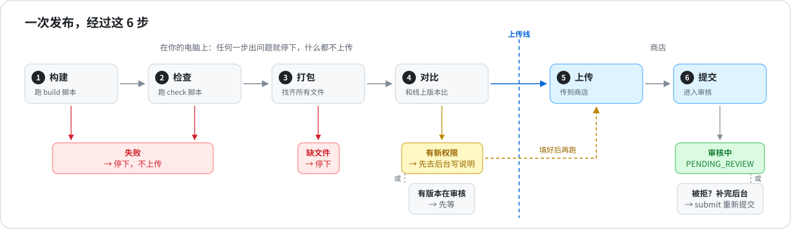
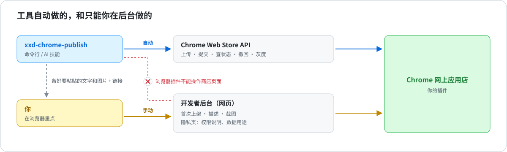

# xxd-chrome-publish

**简体中文** · [繁體中文](README.zh-TW.md) · [English](README.en.md) · [日本語](README.ja.md) · [한국어](README.ko.md) · [Español](README.es.md) · [Français](README.fr.md) · [Deutsch](README.de.md) · [العربية](README.ar.md)

**把 Chrome 插件送上应用商店，从第一次上架到每次更新，都在命令行里完成。**

| 第一次上架 | 商店图片 | 每次更新 |
|---|---|---|
| 读你的代码，按后台的填写顺序准备好商店文案、权限说明、隐私答案，一种语言一个文件夹 | 截图、图标、宣传图，颜色和字体取自插件自己的界面，看起来是同一个产品 | 构建、打包、上传、提交审核；**上传之前**就告诉你商店会不会拒 |

可以当命令用，也可以装进 Claude Code / Codex，直接说「把这个插件发了」「给它准备上架资料」。
MIT 开源。本身不依赖任何 npm 包；截图和做图时，才会自动装一个 playwright-core 到本机缓存。

## 它省掉的麻烦

| 以前 | 用它之后 |
|---|---|
| 上传成功，提交却被拒：*does not meet the requirements* | 预检时就指出哪个新权限要写说明，以及代码里哪一行用到了它 |
| 权限说明、数据披露不知道怎么写，写了也和代码对不上 | 先从代码里查出每个权限的用处、请求了哪些服务器、有没有远程代码，再照着写 |
| 上了 13 种语言，其他语言的商店页全是空的 | 每种语言一个资料文件夹，发布前逐个确认；还能加插件里还没有的语言（日语、韩语、阿拉伯语……） |
| 商店截图里，400px 宽的侧边栏被拉成整张图 | 侧边栏、弹窗自动放回浏览器窗口里截，演示数据、断网，不碰真实账号 |
| 宣传图另配一套颜色，和插件界面不像一家 | 颜色、字体、圆角从插件页面实际渲染的样式里读出来 |
| 后来才加载的文件、第三方库的许可没打进包 | 自动找齐，一起打包 |
| 版本号和商店撞了 | 同时参考代码和商店，算出下一个版本号 |
| 记不清哪些插件有改动还没发 | 一张表全部列出来 |

## 看看效果

用插件「封面拼图」实际跑出来的：


发布前的检查：

```
$ xxd-chrome-publish preflight
Image Crop Tool · ~/code/crop · phdjhhjbapkmagifbejfabimojmjngbe
  store     PUBLISHED 1.0.26
  version   1.0.26 → 1.0.27
  package   27 files · 249 KB
  manifest  vs store: +hosts https://api.example.com/*
  dashboard 1 to-do:
    [required] Justify the new host permissions
    open https://chrome.google.com/webstore/devconsole/…/edit/privacy
  => NEEDS DASHBOARD
```

这次新加了一个网站权限。打开链接写一句为什么需要它、保存，再发布就行——不用等上传、提交、被拒之后才知道。



## 快速开始

**1. 安装**（需要 Node 18+）

```bash
git clone https://github.com/nevertoday/xxd-chrome-publish ~/code/xxd-chrome-publish
sh ~/code/xxd-chrome-publish/scripts/install.sh                       # 当命令用
ln -s ~/code/xxd-chrome-publish ~/.claude/skills/xxd-chrome-publish   # 当 Claude 技能用（Codex 是 ~/.codex/skills）
```

**2. 不用商店账号就能做的**：在插件目录里

```bash
xxd-chrome-publish listing .        # 准备上架资料（第一次上架）
xxd-chrome-publish style .          # 读出插件界面的颜色、字体、圆角
xxd-chrome-publish pack . --patch   # 版本号加一，打一个能上传的 ZIP
```

**3. 要发布时，连上商店账号**（只需一次，[详细步骤](references/setup.md)）

```bash
xxd-chrome-publish setup --publisher-id <后台网址里的 ID> --service-account <服务账号邮箱>
# 每个插件目录一次
xxd-chrome-publish bind --extension-id <扩展 ID 或商店链接>
# 发布
xxd-chrome-publish
```

## 三种情况，各用哪些命令

### 第一次上架

```bash
xxd-chrome-publish listing . --locales ja,ko,ar   # 查代码 + 打包 + 按后台顺序生成填写骨架
xxd-chrome-publish privacy-page .                 # 隐私政策发布成公开网页，网址自动填进资料
xxd-chrome-publish listing . --check              # 验收：没写完的、Markdown 符号、超长摘要、缺的文件
```

生成的资料夹（放在桌面，不进源码）：

```
<插件文件夹>-store-assets/
├── fill-text.md               按后台顺序，从上往下复制粘贴
├── upload-files/              图标、截图、宣传图、隐私网页、ZIP
├── language-versions/<语言>/  每种上架语言一份：粘贴稿、完整说明、隐私政策
└── working/listing-facts.md   证据：每个权限用在哪一行、请求了哪些服务器
```

之后在后台新建条目、上传 ZIP、粘贴；拿到 ID 后 `bind`，第一次发布会先检查登录白名单、审核测试账号、公开支持页面。

### 商店图片

| 你想 | 敲 |
|---|---|
| 截商店截图（按场景文件；`--locale ja` 出日语版） | `xxd-chrome-publish shots . --scenario shots.json` |
| 读出界面风格，给图标和宣传图用 | `xxd-chrome-publish style .` |
| 出 16/32/48/128 图标、商店图标和检查图 | `xxd-chrome-publish icon . --svg icon.svg` |
| 渲染宣传图，并检查文字出画、被裁、折行 | `xxd-chrome-publish tile promo.html --size 1400x560 --out promo.png` |
| 检查尺寸和透明度，出一张商店页预览 | `xxd-chrome-publish images .` |

上传用的图都是商店要求的 24 位、不带透明的 PNG。截图需要本机装有 Google Chrome，第一次用时会自动装 playwright-core 到 `~/.cache`。

### 每次更新

| 你想 | 敲 |
|---|---|
| 先看看会发生什么，什么都不改 | `xxd-chrome-publish preflight` |
| 发布更新 | `xxd-chrome-publish` |
| 后台补完资料，重新提交 | `xxd-chrome-publish submit` |
| 查审核进度 | `xxd-chrome-publish status` |
| 看一个文件夹里哪些插件有改动还没发 | `xxd-chrome-publish scan ~/code` |
| 检查账号配置对不对 | `xxd-chrome-publish doctor` |

## 在 AI 助手里用

装成技能后直接说：

- 「把 flomo 那个插件发了」「看看哪些插件可以发」
- 「给这个插件准备上架资料，要日语、韩语、阿拉伯语」
- 「做五张商店截图和宣传图，风格和插件界面一致」

每次发布结束都有一段固定格式的报告，把三件事分开说：后台资料存了没有、安装包传了没有、提交审核了没有。它不会把「已提交」说成「已上线」——上线要等 Google 审核通过。

## 它做不到的



Google 没有为这些开放接口，只能在 Chrome 开发者后台完成：新建条目、粘贴商店文案和隐私答案、上传图片。工具会把要粘贴的文字和图片按顺序备好，并给出后台链接。Chrome 不允许浏览器插件操作商店页面，所以插件里的 AI 助手填不了；能直接操作电脑的 AI 可以替你填写、保存，再逐项核对。

## 细节（点开看）

<details>
<summary><b>登录方式：两种选一种</b></summary>

| 方式 | 适合 | 需要什么 |
|---|---|---|
| gcloud + 服务账号 | 自己电脑上用，不存密钥文件 | 装 Google Cloud SDK，建一个服务账号 |
| OAuth refresh token | CI（比如 GitHub Actions） | `CWS_CLIENT_ID`、`CWS_CLIENT_SECRET`、`CWS_REFRESH_TOKEN` 三个环境变量 |

⚠️ 服务账号要填在后台 Account 页的 **service account** 那一栏，**不是**旁边的 “Trusted tester accounts”。填错了会一直报 403。

完整步骤：[references/setup.md](references/setup.md)

</details>

<details>
<summary><b>发布的全部参数</b></summary>

| 参数 | 作用 |
|---|---|
| `--minor` / `--major` | 1.2.3 → 1.3.0 / 2.0.0（默认是 1.2.4） |
| `--set-version 1.5.0` | 就用这个版本号 |
| `--no-bump` | 不改版本号，用 manifest.json 里现有的 |
| `--skip-build` / `--skip-checks` | 不跑构建 / 测试脚本 |
| `--dashboard-ready` | 后台已经填好了，继续发 |
| `--cancel-pending` | 撤回审核中的版本，改发这一版 |
| `--upload-only` | 只上传，不提交审核 |
| `--staged` | 审核通过后先不上线，等你手动发布 |
| `--zip 文件.zip` | 直接传这个 ZIP，不重新打包 |
| `--commit` | 发完把新版本号提交到 git |
| `--json` | 输出 JSON，方便程序读取 |
| `--lang zh` / `--lang en` | 结尾报告的语言，以及 ZIP 文件名用哪种语言的商店名；默认跟系统语言 |

退出码：`0` 完成 · `1` 出错 · `2` 有别的版本在审核 · `3` 要先去后台补资料。
商店图片命令各自的参数：`xxd-chrome-publish --help`。

</details>

<details>
<summary><b>每个插件的设置</b>（<code>.chrome-publish.json</code>）</summary>

```json
{
  "extensionId": "abcdefghijklmnopabcdefghijklmnop",
  "build": "npm run build",
  "check": false,
  "packageDir": "dist",
  "include": ["assets/models/**"],
  "exclude": ["fixtures/**"]
}
```

| 字段 | 意思 |
|---|---|
| `extensionId` | 商店链接里那串 32 位字母 |
| `build` | 构建命令，或 `false`。默认用 package.json 里的 `build` 脚本 |
| `check` | 测试命令，或 `false`。默认用 package.json 里的 `check` 脚本 |
| `packageDir` | 要打包的目录，比如构建输出到 `dist` 时填它 |
| `include` / `exclude` | 一定要打包 / 一定不打包的文件 |

</details>

<details>
<summary><b>写给审核员的说明怎么写、报错怎么办</b></summary>

- 第一次上架每个字段的写法：[references/first-listing.md](references/first-listing.md)
- 截图场景文件：[references/screenshots.md](references/screenshots.md) · 图标和宣传图：[references/store-images.md](references/store-images.md)
- 权限说明怎么写才容易过审：[references/dashboard.md](references/dashboard.md)
- 报错和解决办法：[references/troubleshooting.md](references/troubleshooting.md)

</details>

<details>
<summary><b>更新和开发</b></summary>

```bash
git -C ~/code/xxd-chrome-publish pull   # 更新（技能软链和命令都指向这里）
npm test                                # 跑测试（本地假商店，不会真的发布）
npm run diagrams                        # 改了 build.mjs 里的文字后，重新生成示意图
```

</details>

MIT 许可
